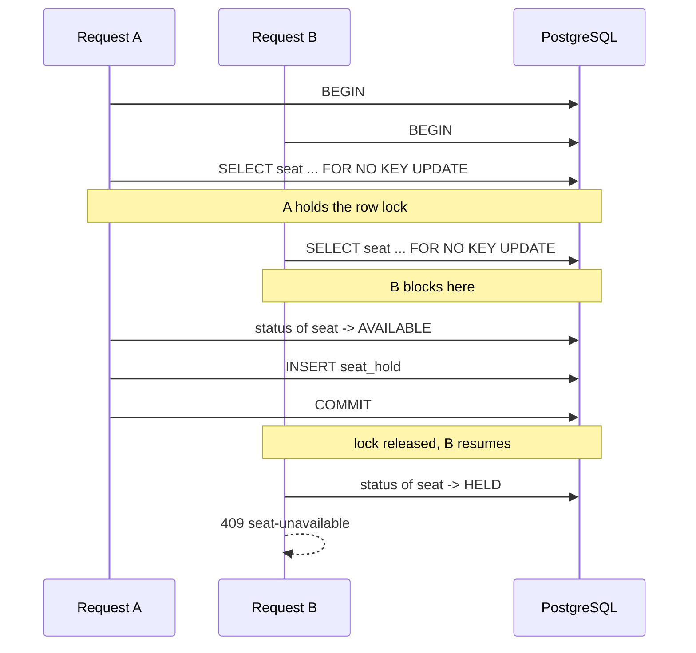
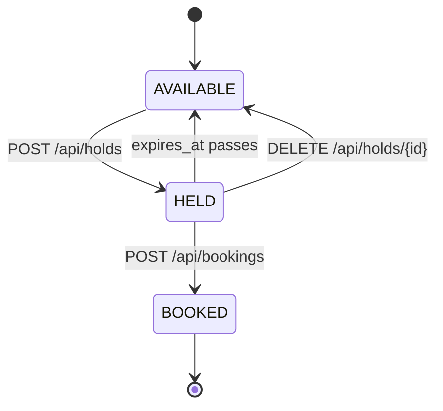
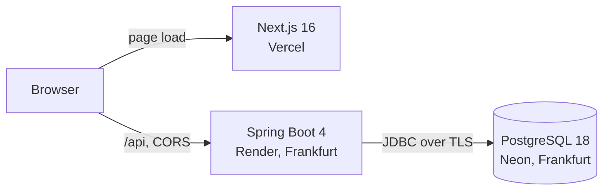

# ScreenBook

A cinema seat booking service built around one problem: when two people claim
the same seat at the same moment, exactly one must win.

The domain is the vehicle. The engineering is the point.

**[Live demo](https://screenbook.vercel.app)** · **[API](https://cinebook-67pa.onrender.com/api/showtimes)** · **[Swagger UI](https://cinebook-67pa.onrender.com/swagger-ui.html)**

> The API runs on a free tier that sleeps after 15 minutes of inactivity. The
> first request wakes it and takes a few seconds. Everything after that is
> normal.

---

## The race

[`/race`](https://screenbook.vercel.app/race) fires two hold requests at the
same seat at the same instant and shows both outcomes side by side. One reads
`201 WON`, the other `409 LOST`. Every time.

The test that proves it releases eight threads from a `CyclicBarrier` onto one
seat, against a real PostgreSQL started by Testcontainers:

| | Winners | Rows in `seat_hold` |
|---|---|---|
| With the row lock | **1** | 1 |
| With the lock removed | **8** | 8 |

That second row is the point. A concurrency test that passes proves very
little, because threads that never overlap pass too. Deleting the lock and
watching the same test fail is what makes it evidence.



Without the lock, both transactions read `AVAILABLE` before either inserts.
Neither read is wrong at the moment it happens: PostgreSQL defaults to `READ
COMMITTED`, where an uncommitted insert by someone else is invisible. That is
write skew, and no amount of careful application code fixes it, because the
check and the write are not atomic with respect to each other.

## Three mechanisms, each where it fits

| Where | Mechanism | Why that one |
|---|---|---|
| Claiming a seat | Row lock, `SELECT ... FOR NO KEY UPDATE` | Contention on one seat is real but lasts under a millisecond. A lock is the cheapest thing that makes the check and the insert atomic. |
| Confirming a hold | Optimistic, `@Version` on `seat_hold` | A double submit is rare, and two confirmations genuinely are two updates to one row, which is the shape optimistic locking is for. |
| Releasing a hold | Conditional `UPDATE ... WHERE booked_at IS NULL` | Check and write in one statement. The loser gets zero rows rather than an exception, because "already released" is not an error for a `DELETE`. |
| Claiming several seats | The same row lock, taken in ascending seat id order | Two requests for the same seats in opposite orders would each hold one and wait for the other. A global order makes that cycle unformable. |
| Retrying a booking | `Idempotency-Key`, claimed before the work | A client that never saw the first response needs the original booking back, not a conflict. Recording the key afterwards would let two concurrent retries both do the work. |
| The invariant underneath | `UNIQUE (showtime_id, seat_id)` on `booking_seat` | The one rule that must hold even if every line of the application is wrong. |

`FOR NO KEY UPDATE` rather than `FOR UPDATE` is deliberate. Inserting a hold
takes a `FOR KEY SHARE` lock on its seat row for the foreign key check, and
`FOR UPDATE` would conflict with that, serialising holds on the same physical
seat across unrelated showtimes. `FOR NO KEY UPDATE` says "I will update this
row but not its key", so foreign key checks pass straight through.

## Seat status is derived, never stored

No column anywhere holds `HELD`. A seat is held only while an unconverted,
unreleased hold has `expires_at > now()`, evaluated per query by a view:

```sql
CREATE VIEW seat_availability AS
SELECT st.id AS showtime_id, s.id AS seat_id, s.row_label, s.seat_number,
       CASE
         WHEN EXISTS (SELECT 1 FROM booking_seat bs
                       WHERE bs.showtime_id = st.id AND bs.seat_id = s.id)
           THEN 'BOOKED'
         WHEN EXISTS (SELECT 1 FROM hold_seat hs
                       JOIN seat_hold h ON h.id = hs.hold_id
                      WHERE hs.showtime_id = st.id AND hs.seat_id = s.id
                        AND h.booked_at IS NULL AND h.released_at IS NULL
                        AND h.expires_at > now())
           THEN 'HELD'
         ELSE 'AVAILABLE'
       END AS status,
       s.tier,
       st.price_minor + t.price_delta_minor AS price_minor
FROM showtime st
JOIN seat      s ON s.screen_id = st.screen_id
JOIN seat_tier t ON t.code      = s.tier;
```

Price is resolved here too, as the showtime's base plus the tier's uplift, so
the seat map and the booking path read the same number and a displayed price
cannot drift from a charged one.

An expired hold frees its seat the instant it expires, with no sweeper
involved. A job that deletes old hold rows is then housekeeping, not
correctness, which is a much better thing to be able to say about a job.



`EXISTS` rather than a left join, because a left join returns one row per match
and would print a seat twice if two live holds ever existed. Correctness that
does not depend on a guarantee made somewhere else is worth two extra
characters.

## Architecture



Writes go through JPA entities, because they need the unit of work and the
version. Reads go through explicit SQL returning records, because the response
shapes are joins across three and four tables that match no entity, and writing
the join is clearer than persuading an ORM to produce it.

Entities hold foreign keys as ids rather than as associations. A hold
references a seat by identity; it does not contain one. The practical effect is
that there is no lazy loading anywhere, so N+1 queries and
`LazyInitializationException` are not failure modes this application can have.

## API

Thirteen endpoints. Full contract in
[docs/api-contract.md](docs/api-contract.md).

| | |
|---|---|
| `GET /api/showtimes` | upcoming screenings with live seat counts |
| `GET /api/showtimes/{id}/seats` | the seat map, status computed per request |
| `POST /api/holds` | claim one to six adjacent seats for 300 seconds |
| `GET /api/holds/{id}` | read a hold and its remaining time |
| `DELETE /api/holds/{id}` | release early |
| `POST /api/bookings` | convert a hold into a booking |
| `GET /api/bookings/{reference}` | read a booking by its `SB-` code |
| `POST /api/auth/signup` | create an account, signed in on success |
| `POST /api/auth/login` | exchange credentials for session cookies |
| `POST /api/auth/refresh` | rotate the session, with reuse detection |
| `POST /api/auth/logout` | revoke the session and clear the cookies |
| `GET /api/me` | the signed-in account |
| `GET /api/me/bookings` | that account's bookings, newest first |

Errors are [RFC 9457](https://www.rfc-editor.org/rfc/rfc9457) problem details
with a distinct `type` URI per case, so clients branch on a stable identifier
rather than on prose:

```json
{
  "type": "https://screenbook.dev/problems/seats-unavailable",
  "title": "Seats unavailable",
  "status": 409,
  "detail": "2 of the 4 seats you chose have just gone.",
  "instance": "/api/holds",
  "unavailableSeats": [
    { "seatId": 1061, "rowLabel": "F", "seatNumber": 1, "status": "BOOKED" },
    { "seatId": 1062, "rowLabel": "F", "seatNumber": 2, "status": "HELD" }
  ]
}
```

Only the lost seats are listed. The client knows what it asked for, so
requested minus unavailable is the set still wanted, and that is also the retry
payload. Anything derivable is left out, because derived data in a response is
data that can disagree with itself.

Catalogue rows use `bigint` ids. Holds and bookings use UUIDv7: a hold id is a
capability, so it has to be unguessable, and v7 is time ordered so the index
appends instead of fragmenting the way random v4 does. A booking reference is
`SB-` plus six characters from an alphabet with no `0`, `1`, `I`, `L`, `O` or
`U`, because people read references aloud. Money is integer minor units, never
a float.

## Running it

```bash
docker compose up -d                 # PostgreSQL 18 on 5432

cd backend && ./gradlew bootRun      # http://localhost:8082
cd frontend && npm install && npm run dev   # http://localhost:3000
```

Flyway applies the migrations on startup, so there is no separate migrate step.
The frontend runs standalone without a backend: `NEXT_PUBLIC_API_MODE=mock`
serves the whole flow from a Mock Service Worker in the browser. Environment
variables are documented in [docs/environment.md](docs/environment.md).

| | |
|---|---|
| API | http://localhost:8082/api |
| Swagger UI | http://localhost:8082/swagger-ui.html |
| Health | http://localhost:8082/actuator/health |

## Tests

```bash
cd backend && ./gradlew test
```

Integration tests run against a real PostgreSQL in a container, not an
in-memory substitute, because the behaviour under test is a PostgreSQL row
lock and an in-memory database would not have it. GitHub Actions runs the same
suite on every push.

## Deliberately out of scope

Deferred with the reasoning recorded, so the omissions read as decisions.

- **Password reset.** Accounts can be created and signed into, but a
  forgotten password cannot be recovered yet. It needs an email provider,
  which would be the only third party this service depends on.
- **Email verification.** Nothing proves an address belongs to whoever typed
  it, which is why my-bookings matches on `user_id` and never on email.
- **Payment.** `pricePaidMinor` records the price at booking time. No money
  moves.
- **GraphQL.** Thirteen fixed-shape resources with no over-fetching problem, and
  an error model that depends on the HTTP status codes GraphQL discards.

## Reversed on purpose

Three things were deferred and then built, and why is more informative than
either half alone.

- **Multi-seat holds**, deferred because the single-seat case already
  demonstrated the locking. Added once that was true: locking one row proves
  the version check, locking several proves the ordering, which is the harder
  half. The first scope was right precisely because it made this one tractable.
- **Idempotency keys**, deferred as mattering only under real retry pressure.
  That was wrong about where the pressure comes from. It is not load, it is one
  person on a bad connection pressing Confirm twice.
- **Authentication**, deferred on the grounds that a hold id is already a
  bearer capability and accounts are orthogonal to the concurrency problem.
  That reasoning held: nothing about the locking changed when accounts
  arrived. What it missed is that "who booked this" is the first question
  anyone asks of a booking system, and the answer being "nobody knows" made
  the rest look unfinished. The concurrency story did not need it. The
  artefact did.

## Next

- **Email verification**, which is what makes claiming a guest booking by its
  address safe. The `booking_by_email` index already exists for it and goes
  deliberately unused until an address can be proven.
- **An exclusion constraint** on `hold_seat`, moving "at most one live hold per
  seat" from a locking convention into the schema, where no future code path
  can bypass it. `released_at` already exists for its predicate.
- **Hexagonal refactor** with ArchUnit enforcing the module boundaries.
- **Redis** for distributed locking once the service is more than one process.
- **Prometheus and Grafana**, and a load test with numbers.
- **Kubernetes and Helm** on Oracle Cloud.

## Stack

| | |
|---|---|
| Backend | Java 21, Spring Boot 4.1.1, Spring Security 7, Hibernate 7, Gradle 9.7 |
| Database | PostgreSQL 18, Flyway 12, HikariCP |
| Frontend | Next.js 16.4, React 19, TypeScript, CSS Modules, MSW |
| Testing | JUnit 5, Testcontainers |
| Docs | springdoc-openapi, Swagger UI |
| Infrastructure | Docker multi-stage, GitHub Actions, Render, Neon, Vercel |
