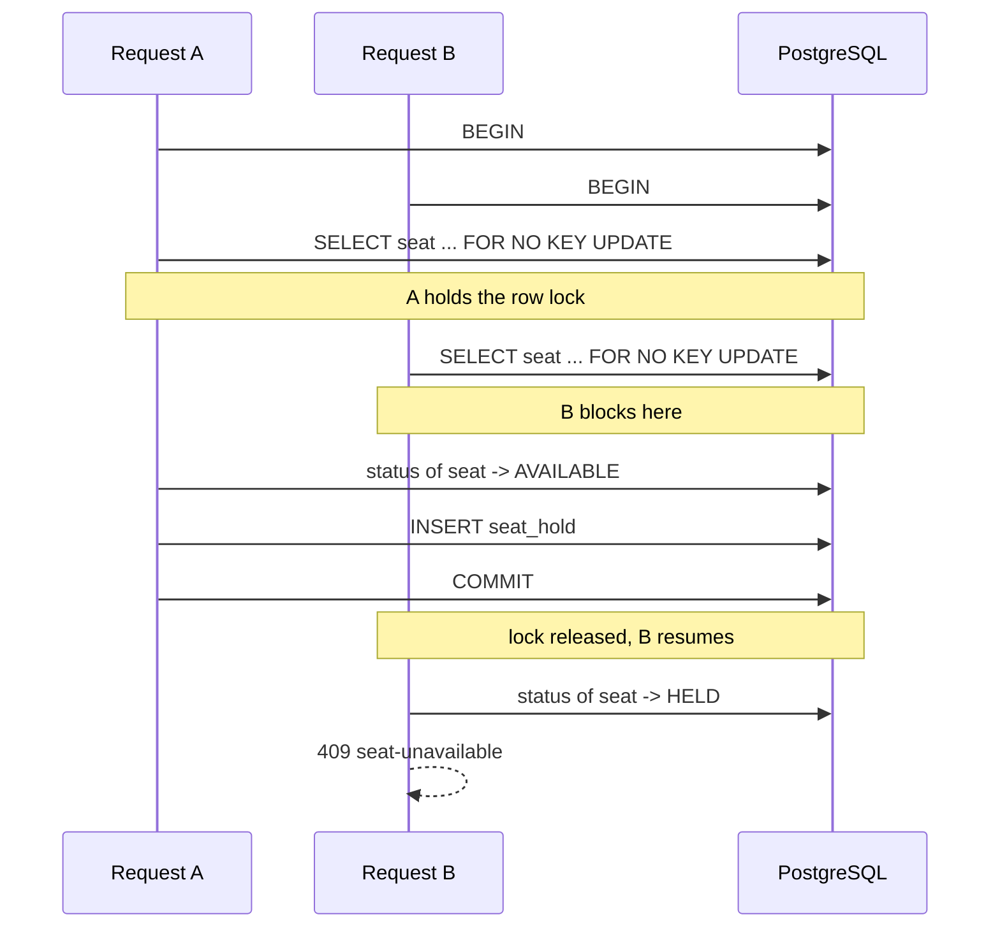
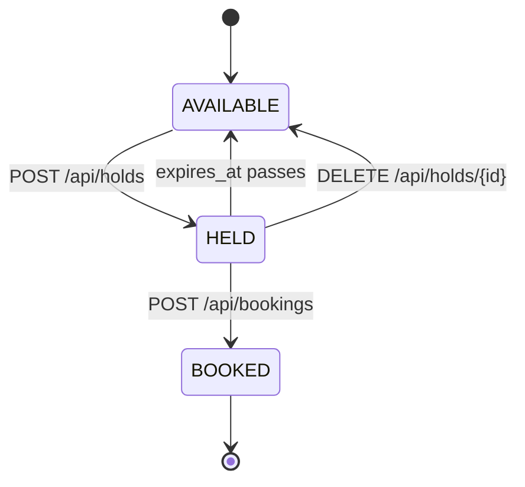
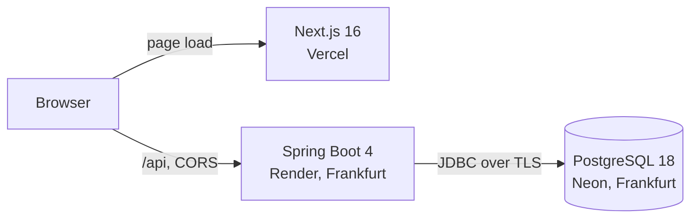
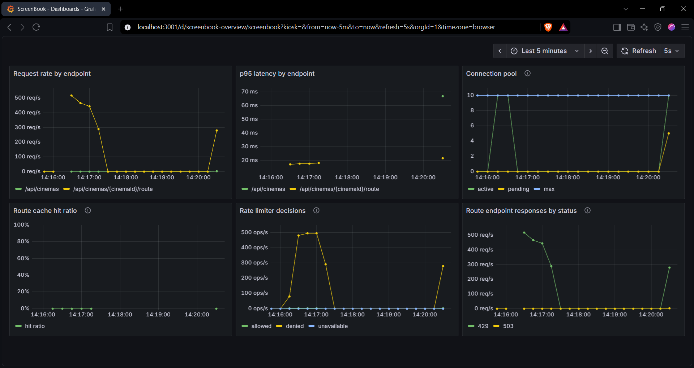

# ScreenBook

[](https://github.com/Mohitvasnani/ScreenBook/actions/workflows/ci.yml)

A cinema seat booking service built around one problem: when two people claim
the same seat at the same moment, exactly one must win.

The domain is the vehicle. The engineering is the point.

**[Live demo](https://screenbook.vercel.app)** · **[API](https://cinebook-67pa.onrender.com/api/showtimes)** · **[Swagger UI](https://cinebook-67pa.onrender.com/swagger-ui.html)**

> The API runs on a free tier that sleeps after 15 minutes of inactivity. The
> first request wakes it and takes a few seconds. Everything after that is
> normal.

---

## The race

[`/race`](https://screenbook.vercel.app/race) fires two hold requests at the
same seat at the same instant and shows both outcomes side by side. One reads
`201 WON`, the other `409 LOST`. Every time.

The test that proves it releases eight threads from a `CyclicBarrier` onto one
seat, against a real PostgreSQL started by Testcontainers:

| | Winners | Rows in `seat_hold` |
|---|---|---|
| With the row lock | **1** | 1 |
| With the lock removed | **8** | 8 |

That second row is the point. A concurrency test that passes proves very
little, because threads that never overlap pass too. Deleting the lock and
watching the same test fail is what makes it evidence.



Without the lock, both transactions read `AVAILABLE` before either inserts.
Neither read is wrong at the moment it happens: PostgreSQL defaults to `READ
COMMITTED`, where an uncommitted insert by someone else is invisible. That is
write skew, and no amount of careful application code fixes it, because the
check and the write are not atomic with respect to each other.

## Three mechanisms, each where it fits

| Where | Mechanism | Why that one |
|---|---|---|
| Claiming a seat | Row lock, `SELECT ... FOR NO KEY UPDATE` | Contention on one seat is real but lasts under a millisecond. A lock is the cheapest thing that makes the check and the insert atomic. |
| Confirming a hold | Optimistic, `@Version` on `seat_hold` | A double submit is rare, and two confirmations genuinely are two updates to one row, which is the shape optimistic locking is for. |
| Releasing a hold | Conditional `UPDATE ... WHERE booked_at IS NULL` | Check and write in one statement. The loser gets zero rows rather than an exception, because "already released" is not an error for a `DELETE`. |
| Claiming several seats | The same row lock, taken in ascending seat id order | Two requests for the same seats in opposite orders would each hold one and wait for the other. A global order makes that cycle unformable. |
| Retrying a booking | `Idempotency-Key`, claimed before the work | A client that never saw the first response needs the original booking back, not a conflict. Recording the key afterwards would let two concurrent retries both do the work. |
| The invariant underneath | `UNIQUE (showtime_id, seat_id)` on `booking_seat` | The one rule that must hold even if every line of the application is wrong. |

`FOR NO KEY UPDATE` rather than `FOR UPDATE` is deliberate. Inserting a hold
takes a `FOR KEY SHARE` lock on its seat row for the foreign key check, and
`FOR UPDATE` would conflict with that, serialising holds on the same physical
seat across unrelated showtimes. `FOR NO KEY UPDATE` says "I will update this
row but not its key", so foreign key checks pass straight through.

## Seat status is derived, never stored

No column anywhere holds `HELD`. A seat is held only while an unconverted,
unreleased hold has `expires_at > now()`, evaluated per query by a view:

```sql
CREATE VIEW seat_availability AS
SELECT st.id AS showtime_id, s.id AS seat_id, s.row_label, s.seat_number,
       CASE
         WHEN EXISTS (SELECT 1 FROM booking_seat bs
                       WHERE bs.showtime_id = st.id AND bs.seat_id = s.id)
           THEN 'BOOKED'
         WHEN EXISTS (SELECT 1 FROM hold_seat hs
                       JOIN seat_hold h ON h.id = hs.hold_id
                      WHERE hs.showtime_id = st.id AND hs.seat_id = s.id
                        AND h.booked_at IS NULL AND h.released_at IS NULL
                        AND h.expires_at > now())
           THEN 'HELD'
         ELSE 'AVAILABLE'
       END AS status,
       s.tier,
       p.price_minor AS base_price_minor
FROM showtime st
JOIN screen    sc ON sc.id        = st.screen_id
JOIN seat      s  ON s.screen_id  = st.screen_id
JOIN seat_tier t  ON t.code       = s.tier
JOIN hall_class_tier_price p
                  ON p.hall_class = sc.hall_class
                 AND p.tier       = s.tier;
```

The listed price is resolved here too, from the hall class and the tier, so
the seat map and the booking path read the same number and a displayed price
cannot drift from a charged one. What moves that number is in
[What a seat costs](#what-a-seat-costs) below.

An expired hold frees its seat the instant it expires, with no sweeper
involved. A job that deletes old hold rows is then housekeeping, not
correctness, which is a much better thing to be able to say about a job.



`EXISTS` rather than a left join, because a left join returns one row per match
and would print a seat twice if two live holds ever existed. Correctness that
does not depend on a guarantee made somewhere else is worth two extra
characters.

## What a seat costs

Two halves, and the split is the point. The listed price is data a human
chose. The rules that move it are a function of live state, so they live in
Java where they can be tested without a database.

| | Normal | Premium | Executive |
|---|---|---|---|
| Standard hall | 200 | 350 | 500 |
| Luxury hall | 300 | 550 | 800 |

Listed, not base plus a global uplift. One uplift is a huge ladder in a cheap
hall and nearly flat in an expensive one, and percentage uplifts produce
prices like 437.50. Every figure above is one a human picked and would be
willing to print, which is what real cinemas publish.

Five rules move it, each contributing a percentage of the listed price:

| Rule | Bands |
|---|---|
| Occupancy | +10% from half full, +20% from 80% |
| Lead time | +5% inside 48 hours, +10% inside 6 |
| Time of day | +5% for an evening screening |
| Day of week | +5% on Friday and Saturday |
| Weeks since release | +15% before release, +10% in the opening week, +5% under four weeks |

They are summed rather than multiplied, so every line of the breakdown is
independently true. Multiplied, the figure printed beside a rule would depend
on which rules happened to fire before it. A cap sits underneath at +55%,
which these five cannot reach between them; it exists so that a mistyped band
cannot produce a four-figure ticket.

`PricingRules` is a pure function of its arguments. `now` arrives as a
parameter rather than a `Clock` field, and there is no repository and no
transaction, which is why its tests are the only ones in the project that do
not need Docker.

The zone arrives the same way. Evening and weekend are questions about local
time, an instant has no local time until a zone names one, and the zone that
matters belongs to the building: it is read from `cinema.timezone` and travels
with the screening into `priceFor`.

There is deliberately no configured fallback. One global zone priced a 19:00
Liverpool screening as an Indian small-hours one, and leaving a default behind
would let the next call site reintroduce that silently. Its absence makes the
compiler name every call site instead. Two tests pin the behaviour: one instant
that is an evening in Jaipur and an afternoon in Liverpool, and one that is
already Friday in Jaipur while it is still Thursday in Liverpool.

### A quote is frozen, a listing is not

The seat map quotes live prices and promises nothing. The promise is made when
a hold is taken, and at that moment the numbers are copied onto it: the listed
price of each tier on `hold_price_group` (a hold can span tiers, so the base
is per tier), the adjusted price per seat on `hold_seat`, and one row per rule
per tier on `hold_price_rule`. Confirming charges the copy.

That is not caution. Occupancy is an input, so recomputing at confirm returns
a different number whenever somebody else books while the customer is typing
their email. The rule labels are copied for the same reason the price is:
rewording a band next month must not retroactively change why last month's
booking cost what it did.

Occupancy is read inside the seat locks and before the insert, so the figure
that sets the price is the one that was true at the instant of the claim. Read
earlier, it prices against a house that has since filled. Read after the
insert, it counts the customer's own seats and lets them inflate their own
price.

`PriceFreezeTest` asserts that the number quoted is the number charged.

## Where the data comes from

The cinemas are real. 980 of them across 40 cities, from OpenStreetMap via
Overpass. Names and coordinates are genuine, and every row carries its OSM type
and id as a column rather than a comment, so any of them can be looked up and
re-running the ingestion is idempotent instead of a hand merge.

It started at 130, from Nominatim, and that number turned out to be an artefact
of the tool rather than a statement about the data. Nominatim is a geocoder: it
ranks its answers and caps them, because it exists to answer "which one did you
mean". Overpass is the bulk query interface to the same database and returns
everything tagged. The first number is what a geocoder will give you. The
second is what is actually there.

Two thirds of those rows have no address, and the column is nullable rather
than filled in. Bulk reverse geocoding through Nominatim is against their usage
policy, a commercial geocoder would dress a vendor's guess from coordinates up
as something a mapper wrote, and composing "Jaipur, Rajasthan" out of the city
column would be inventing data. The map already answers where a building is,
exactly, and the API already sends the distance. Dropping the unaddressed rows
was the other option and it is worse on the numbers: India is 23% addressed
against the UK's 83%, so it would have left the smaller market better covered
than the bigger one and baked a Western mapping bias into the dataset.

Identity comes from the data's own id, not from a name somebody retyped. London
has ten cinemas called Everyman and Bengaluru six called PVR Cinemas, so the
original `UNIQUE (city, name)` would have rejected about 89 of these rows. The
unique key is `(osm_type, osm_id)`, which is what makes "just run the script
again" a real loop.

Everything else is generated and labelled as such. No chain publishes seat maps
or showtimes in a form anyone can use, so the rooms and all the prices are
invented: about 1,800 screens and a quarter of a million seats, built by a rule
rather than by a list. A chain name gets three screens, Raj Mandir gets its one
famous auditorium, everything else gets one or two off its id, and the row and
column counts follow from the aisle pattern. A varied room layout gives the
identical concurrency problem whether it was scraped or generated.

Cinema data © OpenStreetMap contributors, available under the
[Open Database License](https://www.openstreetmap.org/copyright).

The films are real too. Sixty-seven of them, now playing in the UK and India,
from TMDB: titles, runtimes, release dates and poster paths are theirs, and the
screenings those films are shown at are generated. Ingestion runs once offline
in `tools/tmdb_ingest.py` and its output is committed as a migration, so the
running service never calls TMDB. It does call two others at request time,
Brevo for reset mail and openrouteservice for road routes, and both are allowed
to fail: a mail failure is swallowed so it cannot reveal which addresses have
accounts, and a routing failure is a 503 the client answers by keeping a
straight line. Posters are hotlinked from TMDB's CDN and never re-hosted,
which is also why the API sends a poster path rather than a URL: the size
belongs to whatever is rendering it, and baking one in would make changing a
thumbnail an API change.

Films are scoped to where they were released. `film_region` is keyed
`(region, film_id)`, and that column order is the decision worth defending: the
only reader asks "every film showing in GB", and the btree behind the key is
only usable for a predicate on its leading column. The seeder's ring is then
one ring per territory rather than one for the world, partitioned with
`row_number() OVER (PARTITION BY fr.region ...)`, so Liverpool never advertises
a film that opened only in India and Jaipur never advertises one that opened
only in the UK. Territory, not "regional": in Indian cinema regional means the
non-Hindi language industries, which is a different axis entirely.

The home page is a globe. MapLibre's globe projection over MapTiler tiles, with
one accent pin per city, and a camera with a single rule: frame whatever was
asked about. Choosing a country frames that country's cinemas, choosing a city
frames that city's, clicking a cinema flies to its street. All three come from
the same rows the list underneath is built from, so the map and the list cannot
disagree about where anything is, and there is no hand-tuned zoom level in the
project. The countries the dataset covers are revealed rather than drawn:
everything else is washed out in the page background, and the wash fades as you
descend. The whole view was built over an API that did not change, which is the
argument for the API having been designed rather than grown.

What it has gained since is a radius. "Use my location", or any city picked
from the search box, sets an origin; a 5, 10 or 15km control sets a distance;
and the server answers with `ST_DWithin` against the GiST index, returning the
cinemas inside it and the cheapest price on sale at each. The circle is a real
geodesic ring of 96 points on the same sphere model PostGIS measures with, so
the boundary that is drawn and the boundary that is tested are the same
boundary, and the same points frame the camera. Cinemas outside it are dimmed
rather than removed, because one you will not drive to is still worth knowing
is there. An empty radius answers with the nearest cinema outside it and its
price, so the page can say "nothing within 10km, the closest is 34km away and
from 850" instead of showing an empty circle.

The origin does not have to be where you are standing. That is the same feature
as the search box, not a second one: picking a city gives the radius somewhere
to be centred, which is what lets you look at what is on near Jaipur from a desk
in Liverpool. Pitch is a ramp rather than a constant, and the radius view is
flat on purpose: a tilted circle draws half again as wide as it is tall, which
would be untrue about the one number that view exists to set.

Inside a radius the page picks three cinemas, the nearest, the cheapest and the
furthest, and draws a line to each in its own colour with a legend. A cinema that
wins two categories gets one line, named for both. The lines start straight,
using the distance the API already sent, so the feature costs no routing call.
"Show road routes" fetches the real geometry and the figure becomes a distance
and a time. That is the one request that goes through the server to an outside
provider, so it happens on a click only, never on a radius change, and never for
more than the three picks. It goes through the API rather than from the browser,
which keeps the key off the client and puts one cache in front of every viewer:
the origin is snapped to about 110 metres, which is both the cache key and the
most the provider is told about where you are, and an answer is kept for a day.
With no key configured, or the provider down, the endpoint answers 503 and the
lines stay straight, so the map never depends on it.

This product uses the TMDB API but is not endorsed or certified by TMDB.

### Screenings are seeded at startup, not by a migration

A migration runs once. Flyway records it as applied and never revisits it, so
data seeded by one is a photograph of the day it ran, and a demo seeded with a
week of screenings is empty eight days after deploy.

So the seeder does not seed a week. It states a target state:

> every screen has screenings for the next seven days, at times local to its
> cinema, and none in the past

and converges to it on every startup. Idempotency is not a feature added on
top, it falls out of describing a state rather than an action: the second run
finds the state already true and inserts nothing. Roughly 6,400 screenings
across 240 screens, created by one `INSERT ... SELECT` rather than 6,400 round
trips.

`AT TIME ZONE` reads `cinema.timezone`, a column, not a constant. A Jaipur
screening is scheduled on Jaipur's clock and a Liverpool one on Liverpool's,
which is why the zone lives on the cinema: a platform operating in two
countries does not have one evening. The film is assigned off a ring computed
with `row_number()`, positioned by screen and day rather than by slot, so one
screen runs one film across all four of its daily showings and a four-screen
cinema advertises four films a day with four times each. The ring takes
whatever films exist, so three of them and sixty-seven of them run the same
statement.

Expired screenings are deleted as housekeeping, and only ones with no booking
and no hold against them. A screening somebody booked a seat at is their
record, not clutter.

## Architecture



Writes go through JPA entities, because they need the unit of work and the
version. Reads go through explicit SQL returning records, because the response
shapes are joins across three and four tables that match no entity, and writing
the join is clearer than persuading an ORM to produce it.

Entities hold foreign keys as ids rather than as associations. A hold
references a seat by identity; it does not contain one. The practical effect is
that there is no lazy loading anywhere, so N+1 queries and
`LazyInitializationException` are not failure modes this application can have.

## API

Twenty-two endpoints. Full contract in
[docs/api-contract.md](docs/api-contract.md).

| | |
|---|---|
| `GET /api/cinemas` | every cinema, with coordinates, for the map; `?country=` to filter |
| `GET /api/cinemas/cities` | one row per city with a count and a centroid, which is what the globe draws |
| `GET /api/cinemas/nearest` | the nearest few to a point, from one indexed query |
| `GET /api/cinemas/within` | everything inside a radius with its cheapest price, or the nearest cinema outside it |
| `GET /api/cinemas/{id}` | one cinema, with its address and its own timezone |
| `GET /api/cinemas/{id}/route` | the road route to one cinema from a point, proxied from openrouteservice and cached; `503` when the provider is unavailable |
| `GET /api/showtimes?cinemaId=` | upcoming screenings at one cinema, with live seat counts |
| `GET /api/showtimes/{id}` | one screening, for pages reached by URL alone |
| `GET /api/showtimes/{id}/seats` | the seat map, status computed per request |
| `POST /api/holds` | claim seats for 300 seconds, up to five as a guest and ten signed in |
| `GET /api/holds/{id}` | read a hold and its remaining time |
| `DELETE /api/holds/{id}` | release early |
| `POST /api/bookings` | convert a hold into a booking |
| `GET /api/bookings/{reference}` | read a booking by its `SB-` code |
| `POST /api/auth/signup` | create an account, signed in on success |
| `POST /api/auth/login` | exchange credentials for session cookies |
| `POST /api/auth/refresh` | rotate the session, with reuse detection |
| `POST /api/auth/logout` | revoke the session and clear the cookies |
| `POST /api/auth/forgot-password` | start a reset, always `202`, tells the caller nothing |
| `POST /api/auth/reset-password` | set the password and end every session |
| `GET /api/me` | the signed-in account |
| `GET /api/me/bookings` | that account's bookings, newest first |
| `GET /api/me/bookings/upcoming` | that account's bookings for screenings not yet started, soonest first |
| `GET /api/me/bookings/past` | that account's bookings for screenings that have started, most recent first |

Errors are [RFC 9457](https://www.rfc-editor.org/rfc/rfc9457) problem details
with a distinct `type` URI per case, so clients branch on a stable identifier
rather than on prose:

```json
{
  "type": "https://screenbook.dev/problems/seats-unavailable",
  "title": "Seats unavailable",
  "status": 409,
  "detail": "2 of the 4 seats you chose have just gone.",
  "instance": "/api/holds",
  "unavailableSeats": [
    { "seatId": 1061, "rowLabel": "F", "seatNumber": 1, "status": "BOOKED" },
    { "seatId": 1062, "rowLabel": "F", "seatNumber": 2, "status": "HELD" }
  ]
}
```

Only the lost seats are listed. The client knows what it asked for, so
requested minus unavailable is the set still wanted, and that is also the retry
payload. Anything derivable is left out, because derived data in a response is
data that can disagree with itself.

Catalogue rows use `bigint` ids. Holds and bookings use UUIDv7: a hold id is a
capability, so it has to be unguessable, and v7 is time ordered so the index
appends instead of fragmenting the way random v4 does. A booking reference is
`SB-` plus six characters from an alphabet with no `0`, `1`, `I`, `L`, `O` or
`U`, because people read references aloud. Money is integer minor units, never
a float.

## Running it

```bash
docker compose up -d                 # PostgreSQL 18 on 5432, Redis on 6379

cd backend && ./gradlew bootRun      # http://localhost:8082
cd frontend && npm install && npm run dev   # http://localhost:3000
```

Flyway applies the migrations on startup, so there is no separate migrate step.
The frontend runs standalone without a backend: `NEXT_PUBLIC_API_MODE=mock`
serves the whole flow from a Mock Service Worker in the browser. Environment
variables are documented in [docs/environment.md](docs/environment.md).

| | |
|---|---|
| API | http://localhost:8082/api |
| Swagger UI | http://localhost:8082/swagger-ui.html |
| Health | http://localhost:8082/actuator/health |

## Tests

```bash
cd backend && ./gradlew test
```

Integration tests run against a real PostgreSQL in a container, not an
in-memory substitute, because the behaviour under test is a PostgreSQL row
lock and an in-memory database would not have it. GitHub Actions runs the same
suite on every push.

## Observability

Metrics come from Micrometer through Actuator. Prometheus and Grafana run
locally behind a compose profile. They are not part of the deployed service.

```bash
docker compose --profile observability up -d     # Prometheus :9090, Grafana :3001

# backend/, exposing the scrape endpoint for this run only
MANAGEMENT_ENDPOINTS_WEB_EXPOSURE_INCLUDE=health,info,metrics,prometheus ./gradlew bootRun
```



One laptop, with k6 on the same machine, so the shape is the point and the
numbers are not production figures. The left half is a route-abuse run against a
provider that refuses at once: 30 requests spend the bucket and every request
after that is a 429. The 30 allowed ones are invisible beside about 500 a second
denied. The burst on the right is the hold-under-read-load run, which fills the
connection pool.

- **Production exposes `health` and `info` only.** The security chain ends in
  `permitAll`, so anything exposed is public. A test reads the real property
  file and asserts that Prometheus and the metrics endpoint are a 404.
- **p95 comes from histogram buckets**, so Prometheus computes it and it stays
  meaningful across instances.
- **The limiter counts every decision by outcome and nothing else.** One tag
  keeps the series count fixed. `unavailable` is the fail-open count, the signal
  that the limiter has stopped protecting the quota.

Each panel and the decision behind it are in
[docs/observability.md](docs/observability.md).

## Deliberately out of scope

Deferred with the reasoning recorded, so the omissions read as decisions.

- **Email verification.** Nothing proves an address belongs to whoever typed
  it, which is why my-bookings matches on `user_id` and never on email.
- **Payment.** `pricePaidMinor` records the price at booking time. No money
  moves.
- **GraphQL.** Twenty-two fixed-shape resources with no over-fetching problem, and
  an error model that depends on the HTTP status codes GraphQL discards.

## Reversed on purpose

Four things were deferred and then built, and why is more informative than
either half alone.

- **Multi-seat holds**, deferred because the single-seat case already
  demonstrated the locking. Added once that was true: locking one row proves
  the version check, locking several proves the ordering, which is the harder
  half. The first scope was right precisely because it made this one tractable.
- **Idempotency keys**, deferred as mattering only under real retry pressure.
  That was wrong about where the pressure comes from. It is not load, it is one
  person on a bad connection pressing Confirm twice.
- **Password reset**, deferred because it needs a mail provider and nothing
  else depended on it. Built once accounts existed, because an account you can
  be locked out of forever is not really an account. The provider sits behind
  a `Mailer` interface with a logging implementation, so the suite still needs
  nothing but Docker, and an unknown address, a rate-limited one and a real
  one are indistinguishable from outside.
- **Authentication**, deferred on the grounds that a hold id is already a
  bearer capability and accounts are orthogonal to the concurrency problem.
  That reasoning held: nothing about the locking changed when accounts
  arrived. What it missed is that "who booked this" is the first question
  anyone asks of a booking system, and the answer being "nobody knows" made
  the rest look unfinished. The concurrency story did not need it. The
  artefact did.

## Next

- **Email verification**, which is what makes claiming a guest booking by its
  address safe. The `booking_by_email` index already exists for it and goes
  deliberately unused until an address can be proven.
- **An exclusion constraint** on `hold_seat`, moving "at most one live hold per
  seat" from a locking convention into the schema, where no future code path
  can bypass it. `released_at` already exists for its predicate.
- **Hexagonal refactor** with ArchUnit enforcing the module boundaries.
- **Redis** is in for rate limiting on the route endpoint. A distributed lock
  is deliberately not planned: Postgres already fills that role.
- **Kubernetes and Helm** on Oracle Cloud.

## Stack

| | |
|---|---|
| Backend | Java 21, Spring Boot 4.1.1, Spring Security 7, Hibernate 7, Gradle 9.7 |
| Database | PostgreSQL 18 with PostGIS 3.6, Flyway 12, HikariCP |
| Frontend | Next.js 16.4, React 19, TypeScript, CSS Modules, MSW |
| Maps | MapLibre GL JS 6 (globe projection), MapTiler vector tiles and Countries, OpenStreetMap data |
| Routing | openrouteservice (driving-car), behind the API, cached with Caffeine |
| Rate limiting | Redis, a token bucket in one Lua script, in front of the routing provider |
| Observability | Micrometer, Prometheus and Grafana, local only |
| Testing | JUnit 5, Testcontainers |
| Docs | springdoc-openapi, Swagger UI |
| Mail | Brevo, behind a `Mailer` interface with a logging implementation |
| Infrastructure | Docker multi-stage, GitHub Actions, Render, Neon, Vercel |
